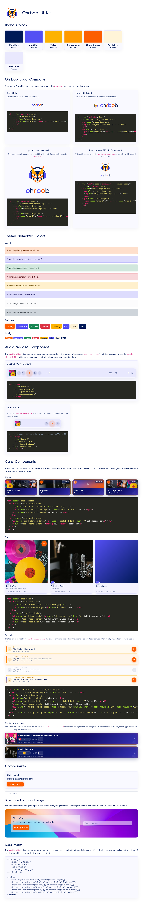

# Ohrbob Bootstrap Theme

A custom Bootstrap 5 SCSS theme implementing a "Frosted Neon" glassmorphism aesthetic for the Ohrbob audio application.



## Prerequisites

- Node.js (which includes npm)

## Setup

1. Install the dependencies (which includes Dart Sass and Bootstrap):

```bash
npm install
```

## Viewing the Theme locally

You can view the theme in action by opening `index.html` in your browser.

To recompile the theme and watch for changes while you edit the `.scss` files, run:

```bash
npm run watch
```

To just build the CSS once, run:

```bash
npm run build
```

## Applying to the Ohrbob.Web Project

You can automatically build and deploy the theme, logos, favicons, and scripts directly to your local ASP.NET Core project using the `apply` command. 

Run the following command, passing the path to the target `Ohrbob.Web` directory:

```bash
npm run apply -- ../ohrbob2/Ohrbob.Web/
```

*(Note: Depending on your npm version, you may need the `--` to pass the directory argument correctly. If you omit the argument, it defaults to `../ohrbob2/Ohrbob.Web`)*

## Manual Usage in an ASP.NET Core Application

To use this compiled CSS theme in your ASP.NET Core project:

1. Build the CSS by running `npm run build` in this directory.
2. The generated CSS file will be located at `css/theme.css`.
3. Copy `css/theme.css` into your ASP.NET Core project's `wwwroot/css/` directory.
4. In your `_Layout.cshtml` (or whichever layout file you use), include a link to the copied CSS file, replacing the default bootstrap CSS if necessary:

```html
<link rel="stylesheet" href="~/css/theme.css" />
```

Alternatively, you could configure your ASP.NET Core build process or tools like LibMan / WebCompiler to automatically compile the SCSS files from this repository directly into your `wwwroot/css/` directory.

## First Publication & Intellectual Property Notice

"Ohrbob" and its associated visual logo were first published on 6.10.2026 by Kai Wegner in Germany/EU. 

- Project Title Rights: Claimed under § 5 Abs. 3 MarkenG (Werktitel).
- Visual Assets & Logo: Protected under EU Unregistered Community Design (Regulation EC No 6/2002).
- Copyright & Source Code: Copyright (C) 2026 Kai Wegner. Licensed under the GNU Lesser General Public License, version 3 or later (LGPL-3.0-or-later). See [LICENSE](LICENSE).