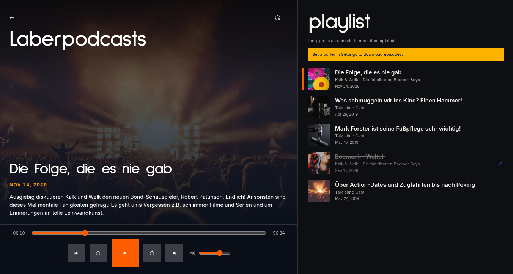
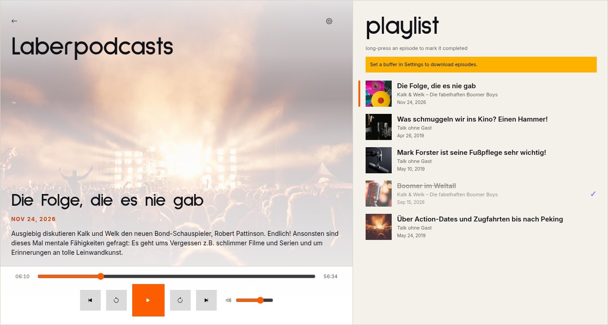

# Ohrbob Metro Theme

A Bootstrap 5 SCSS theme that mirrors the Ohrbob player's Metro UI: warm paper
and near-black canvases, Sulphur Point display type, flat square components,
and the orange / violet / yellow brand accents.

The theme keeps the existing `Ohrbob.Web` class names (`card-station`,
`card-feed`, `card-episode`, `glass-panel`, `audio-widget`, …), so applying it
does not require rewriting the views.



Light mode:



## Prerequisites

- Node.js (which includes npm)

## Setup

1. Install the dependencies (which includes Dart Sass and Bootstrap):

```bash
npm install
```

## Viewing the Theme locally

Open `index.html` in your browser. The showcase includes live previews of the
stations, player, playlist and connect screens, plus the component gallery.

The theme toggle in the header switches between light and dark mode. Append
`?theme=dark` or `?theme=light` to force a mode for screenshots.

To recompile the theme and watch for changes while you edit the `.scss` files,
run:

```bash
npm run watch
```

To build the CSS and refresh the preview screenshots once:

```bash
npm run build
```

## Applying to the Ohrbob.Web Project

You can automatically build and deploy the theme, logos, favicons, and scripts
directly to your local ASP.NET Core project using the `apply` command.

Run the following command, passing the path to the target `Ohrbob.Web`
directory:

```bash
npm run apply -- ../ohrbob2/Ohrbob.Web/
```

*(Note: Depending on your npm version, you may need the `--` to pass the
directory argument correctly. If you omit the argument, it defaults to
`../ohrbob2/Ohrbob.Web`)*

## Manual Usage in an ASP.NET Core Application

To use this compiled CSS theme in your ASP.NET Core project:

1. Build the CSS by running `npm run build` in this directory.
2. The generated CSS file will be located at `css/theme.css`.
3. Copy `css/theme.css` into your ASP.NET Core project's `wwwroot/css/`
   directory.
4. In your `_Layout.cshtml` (or whichever layout file you use), include a link
   to the copied CSS file, replacing the default Bootstrap CSS if necessary:

```html
<link rel="stylesheet" href="~/css/theme.css" />
```

Alternatively, you could configure your ASP.NET Core build process or tools
like LibMan / WebCompiler to automatically compile the SCSS files from this
repository directly into your `wwwroot/css/` directory.

## Design Notes

- Light canvas `#f4f1ea`, ink `#111217`; dark canvas `#0e0f13`, ink `#f7f4ed`.
- Flat corners and hairline borders replace the previous glass/blur look.
- Station tiles use a 2×2 cover mosaic, an orange accent bar and a single-line
  Sulphur Point title.
- Episode rows use a 58px square cover, an orange current-episode tab and the
  same metadata hierarchy as the player playlist.
- The audio widget keeps its web-component markup but renders as the player's
  two-row transport deck.

## First Publication & Intellectual Property Notice

"Ohrbob" and its associated visual logo were first published on 6.10.2026 by
Kai Wegner in Germany/EU.

- Project Title Rights: Claimed under § 5 Abs. 3 MarkenG (Werktitel).
- Visual Assets & Logo: Protected under EU Unregistered Community Design
  (Regulation EC No 6/2002).
- Copyright & Source Code: Copyright (C) 2026 Kai Wegner. Licensed under the
  GNU Lesser General Public License, version 3 or later
  (LGPL-3.0-or-later). See [LICENSE](LICENSE).
